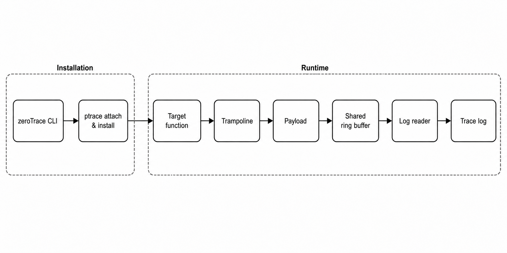

# zeroTrace

**A lightweight dynamic probe for Linux user space.**

[](./LICENSE)
[](#requirements)
[](#requirements)

zeroTrace is a lightweight user-space dynamic tracing tool for Linux. It attaches to a running process via `ptrace`, injects an in-process payload, and rewrites target function prologues to redirect execution through trampolines. Argument capture, return-value recording, filtering, and ring-buffer writes all run inside the target process—avoiding a context switch into the tracer on every probe hit.

> [!WARNING]
> zeroTrace is currently experimental. Because it dynamically modifies instructions and control flow in running processes, always validate it in a recoverable test environment first and avoid attaching it directly to critical production workloads.

## Table of Contents

- [Features](#features)
- [Architecture](#architecture)
- [Requirements](#requirements)
- [Building](#building)
- [Quick Start](#quick-start)
- [CLI Reference](#cli-reference)
- [Function Signatures](#function-signatures)
- [Repository Layout](#repository-layout)
- [Testing](#testing)
- [Benchmarks](#benchmarks)
- [Known Limitations](#known-limitations)
- [Contributing](#contributing)
- [License](#license)

## Features

- **Zero-recompilation dynamic attachment**: Attach directly to running Linux processes without rebuilding or restarting the target binary.
- **Entry and return probes**: Trace both function entry and return events for user-space symbols.
- **Rich argument & return capture**: Capture the first 6 integer/pointer arguments alongside formatted floating-point arguments and return values.
- **Runtime probe lifecycle control**: Dynamically `enable`, `disable`, and `untrace` probes on the fly.
- **Conditional filtering & hot updates**: Filter probe hits with C-like expressions, hot-update probe rules, and trigger in-probe `call` actions without detaching.
- **Multi-probe & multithreaded support**: Run multiple concurrent probes safely with thread-group-level stop/continue control on multithreaded targets.
- **Multi-architecture ISA backends**: Native instruction rewriting and trampoline support for both `x86_64` and `aarch64`.
- **Timeline-friendly trace output**: Emit `perf script` / `ftrace`-style logs (`CLOCK_MONOTONIC` timestamps) that can be merged chronologically across log sources.

## Architecture



zeroTrace operates in two phases:

1. **Installation**: The tracer attaches to the target process via `ptrace`, injects `libzt_payload.so`, allocates a trampoline, and patches the target function entry.
2. **Runtime**: When a probed function is invoked, execution jumps through the trampoline into the in-process payload, which evaluates filters/actions and writes trace events into a shared ring buffer.
3. **Collection**: The tracer asynchronously drains the shared ring buffer, formats events using configured function signatures, and streams them to both the terminal and a trace log file.

## Requirements

zeroTrace supports **Linux** on **`x86_64`** and **`aarch64`**.

### Build & Runtime Dependencies

- GCC and GNU Make
- [Capstone](https://www.capstone-engine.org/) (`libcapstone-dev`)
- GNU Readline (`libreadline-dev`)
- Python 3 (for automated test checks, log merging, and benchmarks)
- `bpftrace` *(optional, only required for kernel `uprobe` comparison benchmarks)*

On Debian / Ubuntu:

```bash
sudo apt update
sudo apt install build-essential libcapstone-dev libreadline-dev python3
```

To enable kernel `uprobe` benchmark comparisons:

```bash
sudo apt install bpftrace
```

> [!NOTE]
> zeroTrace relies on `ptrace` to attach to running processes. If your system enforces Yama `ptrace` restrictions, review the security implications and adjust `/proc/sys/kernel/yama/ptrace_scope` (or run with appropriate capabilities) as needed for your environment.

## Building

Clone the repository and build for the host architecture:

```bash
git clone https://github.com/kahonanami/zeroTrace.git
cd zeroTrace
make
```

Explicitly select an ISA backend or cross-compile:

```bash
make ARCH=x86_64
make ARCH=aarch64
make ARCH=aarch64 CC=aarch64-linux-gnu-gcc
```

Clean build artifacts:

```bash
make clean
```

### Build Artifacts

| Path | Description |
| --- | --- |
| `bin/ztrace` | Interactive tracer CLI |
| `bin/libzt_payload.so` | Shared library payload injected into target processes |
| `bin/tests/test_loop` | Standalone demo target for manual CLI walkthroughs |

## Quick Start

1. Start the demo target program in one terminal:

   ```bash
   ./bin/tests/test_loop
   ```

2. Launch the zeroTrace interactive CLI in another terminal:

   ```bash
   ./bin/ztrace
   ```

3. Attach to the target PID and install probes:

   ```text
   attach <pid>
   trace add_loop
   trace fp_add_loop
   ```

4. Observe trace events streamed to the terminal and saved to `ztrace.<pid>.log`:

   ```text
   test_loop-532386/532386 [010] 58915.513461172: ztrace:entry: add_loop(24, 25)
   test_loop-532386/532386 [010] 58915.513468205: ztrace:return: add_loop -> 49
   test_loop-532386/532386 [010] 58915.513461172: ztrace:entry: fp_add_loop(24.25, 1.5)
   test_loop-532386/532386 [010] 58915.513468205: ztrace:return: fp_add_loop -> 25.75
   ```

5. Cleanly remove probes, detach, and exit:

   ```text
   untrace add_loop
   untrace fp_add_loop
   detach
   quit
   ```

### Merging with `perf` / `ftrace` Logs

Use [`scripts/merge_trace_events.py`](./scripts/merge_trace_events.py) to merge zeroTrace logs with `perf script` or `ftrace` logs sharing the same clock domain (`CLOCK_MONOTONIC`):

```bash
python3 scripts/merge_trace_events.py ztrace.<pid>.log perf.script.log -o merged.log
```

## CLI Reference

The interactive shell supports the following commands:

| Command | Description |
| --- | --- |
| `help` | Display available commands and usage |
| `attach <pid>` | Attach to a running process by PID |
| `detach` | Detach from the currently attached process |
| `trace <symbol>` | Register and enable entry/return probes on `<symbol>` |
| `trace <symbol> if <expr>` | Register a conditional probe matching `<expr>` |
| `update <symbol\|id> if <expr>` | Hot-update a probe's filter expression |
| `update <symbol\|id> clear` | Clear the filter expression on a probe |
| `update <symbol\|id> call <callee> [args...]` | Configure an in-probe call action (`arg0`–`arg5` or `0x...` immediates) |
| `update <symbol\|id> call clear` | Clear a probe's in-probe call action |
| `enable <symbol\|id>` | Re-enable a disabled probe |
| `disable <symbol\|id>` | Temporarily disable a specific probe |
| `disable all` | Temporarily disable all probes |
| `untrace <symbol\|id>` | Uninstall and remove a probe |
| `info target` | Show attached target process information |
| `info probes` | List installed probes and their IDs/states |
| `stop` | Pause the target process while keeping probes intact |
| `continue` | Resume a stopped target process |
| `quit` / `exit` | Exit the CLI |

### Conditional Filter Expressions

Filter expressions support:

- **Operands**: `arg0` through `arg5`, decimal literals, and hexadecimal literals (`0x...`)
- **Comparison operators**: `==`, `!=`, `>`, `<`, `>=`, `<=`
- **Arithmetic operators**: `+`, `-`, `*`, `/`
- **Logical operators**: `&&`, `||`, `!`
- **Grouping**: parentheses `(...)`

Example:

```text
trace write if arg0 == 1 && arg2 > 0
```

Probes can be managed either by symbol name or by the numeric ID shown in `info probes`.

## Function Signatures

[`conf/zttrace.conf`](./conf/zttrace.conf) defines function signatures used to format arguments and return values when a traced symbol is hit.

### Syntax

```text
function_name(arg_type arg_name, arg_type arg_name, ...) -> return_type
```

### Examples

```text
read(int fd, buffer buf, size_t count) -> long
write(int fd, const buffer buf, size_t count) -> long
printf(const char *fmt, ...) -> int
fp_add_loop(double lhs, double rhs) -> double
```

Functions without an entry in `conf/zttrace.conf` automatically fall back to raw register-style argument formatting.

## Repository Layout

| Path | Description |
| --- | --- |
| `conf/` | Function signature definitions for argument and return-value formatting |
| `include/` | Public header files |
| `src/` | Core tracer, injector, payload, filter, and CLI implementation |
| `src/isa/` | Architecture-specific backends (`x86_64`, `aarch64`, and shared ISA helpers) |
| `src/test/` | Automated test suites, fixtures, benchmarks, and manual demo targets |
| `scripts/` | Benchmark harness, architecture config verification, and trace log merger |
| `assets/` | Images and diagrams used in documentation |

## Testing

Build and run the full automated test suite:

```bash
make test
```

The suite covers probe lifecycle management, argument and return capture, dynamic enable/disable toggling, conditional filters, call actions, hot updates, multi-probe coexistence, multithreading, signal safety, shared ring-buffer edge cases, and ISA instruction rewriting (`x86_64` and `aarch64`), along with build-config and log-merger self-tests.

For details on test organization and coverage, see [`src/test/README.md`](./src/test/README.md).

## Benchmarks

Run the benchmark suite:

```bash
make benchmark
```

The benchmark harness measures:

- Baseline (untraced) execution throughput
- zeroTrace probe execution overhead
- Kernel `uprobe` comparison via `bpftrace` *(automatically skipped if `bpftrace` or tracingfs permissions are unavailable)*
- Probe install/uninstall latency

Results are written to `benchmark/report.txt`. You can customize run parameters via environment variables:

```bash
ZT_BENCH_ITERATIONS=1000000 ZT_BENCH_REPEATS=5 ZT_BENCH_LATENCY_ROUNDS=1000 make benchmark
```

> [!NOTE]
> Performance numbers vary significantly depending on CPU microarchitecture, kernel version, compiler flags, and system load. Always re-measure on your target environment and record full test conditions when reporting results.

## Known Limitations

- Supports Linux on `x86_64` and `aarch64` only.
- Attaching to target processes requires sufficient `ptrace` permissions.
- Dynamic instruction rewriting is sensitive to target binary code layout, ABI conventions, and thread timing, and may not be compatible with every binary.
- Human-readable argument and return-value formatting depends on entries in [`conf/zttrace.conf`](./conf/zttrace.conf).
- zeroTrace is a user-space dynamic probe tool, not a full debugger; it does not trace kernel functions or kernel tracepoints.

## Contributing

Contributions, bug reports, and feature requests are welcome—please open an issue or submit a pull request.

Before submitting a pull request:

1. Run `make test` and ensure all automated tests pass.
2. If your change touches the probe execution path or an ISA backend (`src/isa/`), include benchmark results (`make benchmark`) along with your test environment details (architecture, CPU, kernel version, and compiler).

## License

zeroTrace is licensed under the [GNU General Public License v3.0](./LICENSE).
